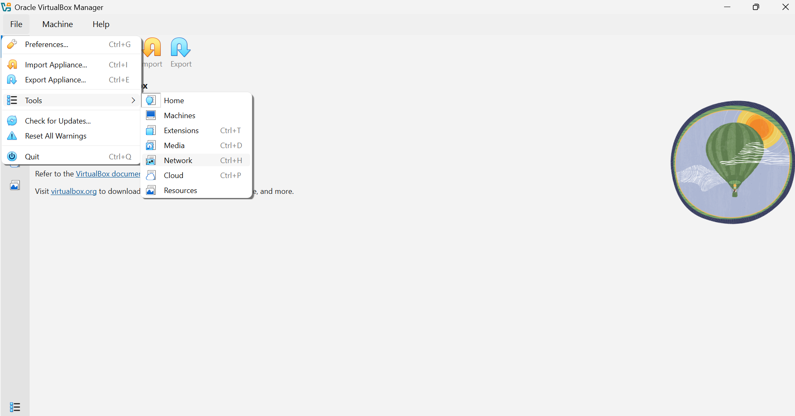
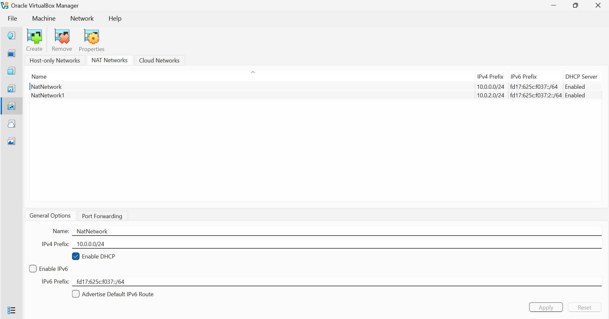
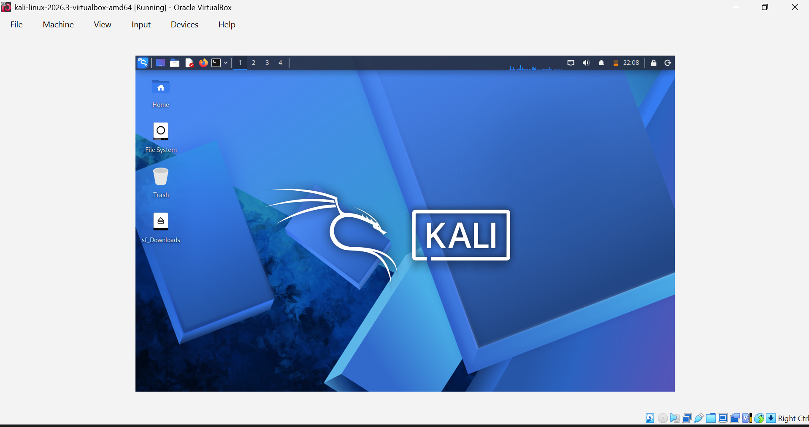
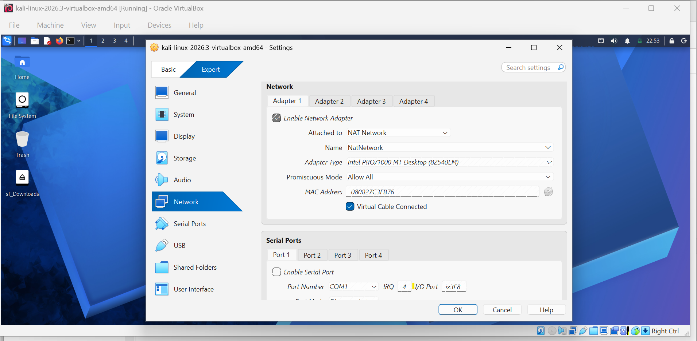
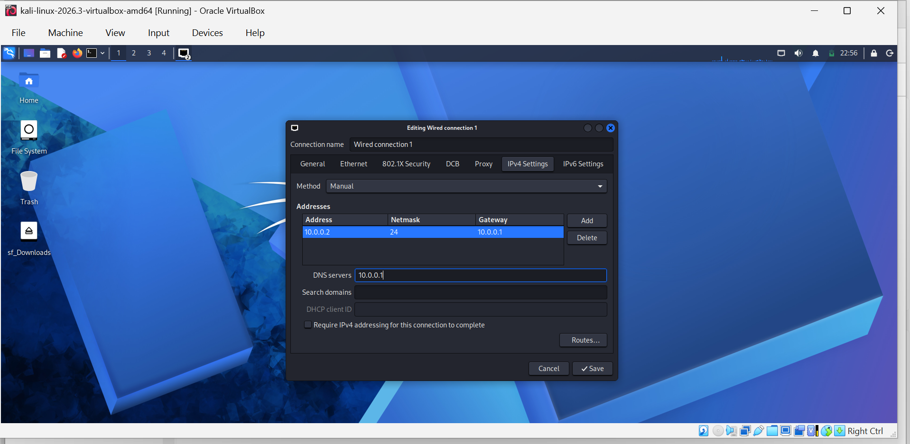
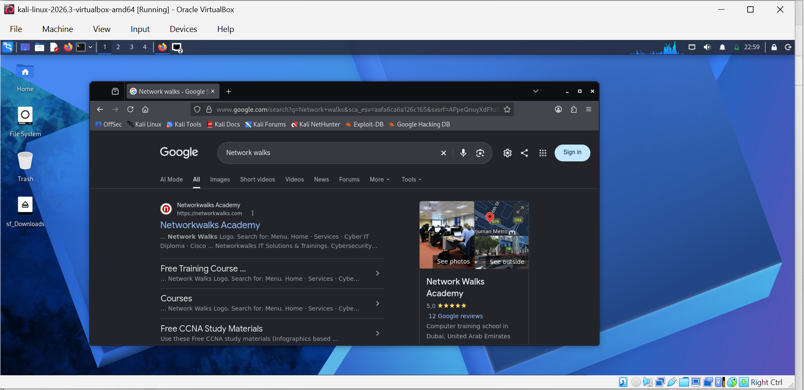
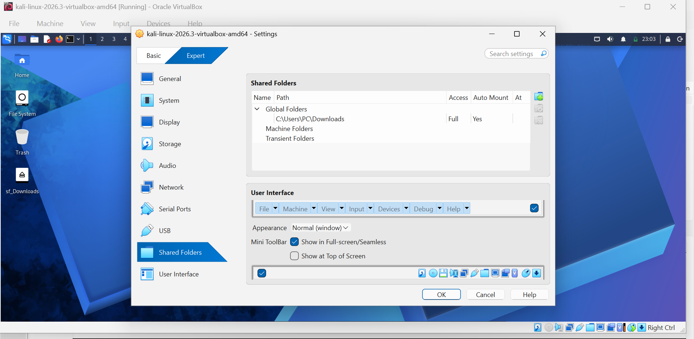

# kali-linux-virtualbox-cybersecurity-lab
Documentation of my cybersecurity lab setup using Kali Linux, VirtualBox, and a custom NAT network, including static IP configuration, network troubleshooting, and virtual machine integration.
# Kali Linux Cybersecurity Lab Setup

## Project overview

This project documents my hands-on setup of a cybersecurity practice lab using **Kali Linux**, **Oracle VirtualBox**, and a **Kubuntu host machine**. It was completed as part of my learning journey in Ethical Hacking with Networkwalks Academy.

The goal was to prepare a virtual environment for learning and testing while keeping the lab network separate from my home network.

## Objectives

- Run Kali Linux as a virtual machine in VirtualBox.
- Configure a custom NAT Network for the lab.
- Configure the virtual machine's network settings, including a static IP address, gateway, and DNS.
- Enable clipboard, drag-and-drop, and shared-folder integration between the host and virtual machine.
- Practise troubleshooting network connectivity.

## Tools and environment

- **Host operating system:** Kubuntu Linux
- **Virtualisation software:** Oracle VirtualBox
- **Guest operating system:** Kali Linux
- **Networking:** VirtualBox NAT Network and manual network configuration
- **Network troubleshooting tool:** `nmcli`

## Work completed

### 1. Located VirtualBox network settings

I opened the VirtualBox network tools to access the network configuration options.

### 2. Reviewed and configured the NAT Network

I used VirtualBox's NAT Network settings to create or configure a network for the lab. The intention was to keep the virtual lab separate from the home network while allowing internet access.

### 3. Started Kali Linux

I imported and started the Kali Linux virtual machine in VirtualBox.

### 4. Connected the Kali virtual machine to the NAT Network

I reviewed the virtual machine's network adapter settings and selected the NAT Network for its connection.

### 5. Configured the wired connection

Inside Kali Linux, I worked with the wired connection settings to configure the network address and related settings.

### 6. Checked connectivity

I opened a browser in Kali Linux to check internet access. During setup, I also investigated a connectivity issue using `nmcli` and adjusted the connection's DAD timeout setting.

### 7. Configured a shared folder

I reviewed VirtualBox's Shared Folders settings to make a Downloads folder available between the host and the Kali virtual machine.

## Key learning outcomes

- Navigating VirtualBox network configuration.
- Understanding how a NAT Network can be used in a virtual lab.
- Configuring a virtual machine's network connection.
- Working with static IP, gateway, and DNS settings.
- Using `nmcli` as part of network troubleshooting.
- Configuring shared folders and other host–guest integration features.

## Security considerations

This lab is intended for authorised learning and testing. Keep virtual lab systems appropriately isolated, and only test systems and networks you own or have explicit permission to assess. Network isolation depends on the actual VirtualBox and guest operating system configuration, so verify the settings before conducting any testing.

## Next steps

- Record the final IP address, subnet, gateway, and DNS values used in the lab.
- Add terminal output showing successful connectivity tests, such as `ip address`, `ip route`, and appropriate ping or DNS checks.
- Document any additional ethical hacking exercises performed in this isolated environment.

## Acknowledgements

This work was completed as part of my Ethical Hacking learning journey with **Networkwalks Academy**. Thank you to **Waqas Karim (CCIE)** for the practical guidance.

---

*This repository documents my own setup process and learning notes. Screenshots are included as evidence of the configuration steps.*

